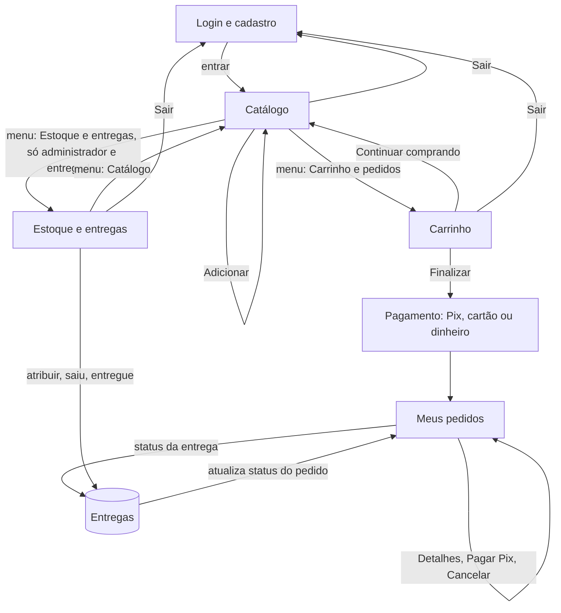

# Fluxo das telas

O sistema tem três telas, uma de cada integrante, ligadas por um menu igual em todas.

| Tela | Responsável | Endereço | Quem acessa |
|---|---|---|---|
| Login e catálogo | João Gabriel | https://delivery-bebidas-front-joao.onrender.com | Todos |
| Carrinho e pedidos | Caio Barsi | https://delivery-bebidas-front.onrender.com | Usuário logado |
| Estoque e entregas | Vitor Costa | https://delivery-bebidas-front-vitor.onrender.com | Administrador e entregador |

## Como a sessão passa de uma tela para outra

Cada tela está em um endereço diferente, então o navegador não compartilha o login entre elas. Ao clicar no menu, a tela envia a sessão no fim do link (`#sessao=...`). A tela de destino guarda a sessão e limpa o endereço. Ao sair, o link leva `#sair`, e a tela de destino apaga a sessão.

## Menu

| Item | Aparece para |
|---|---|
| Catálogo | Todos |
| Carrinho e pedidos (quantidade de itens) | Todos |
| Estoque e entregas | Administrador e entregador |
| Olá, nome / Sair | Usuário logado |
| Entrar | Visitante |
